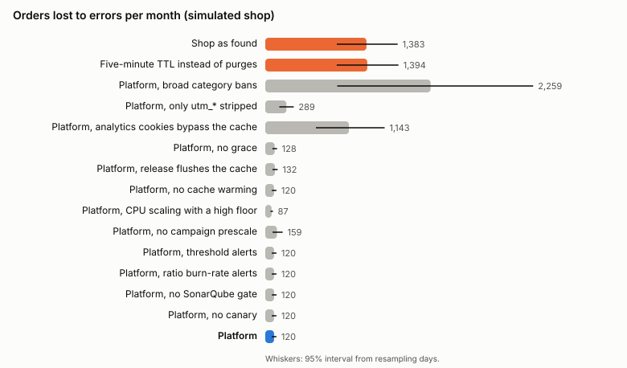
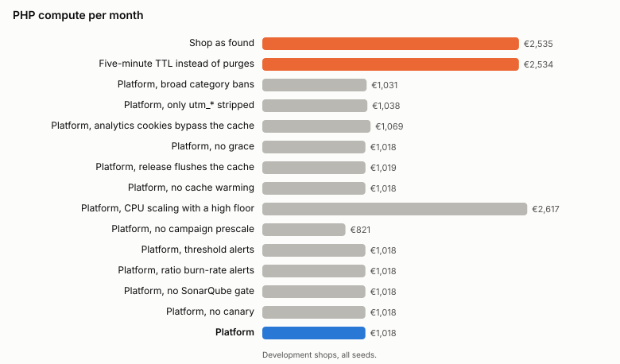
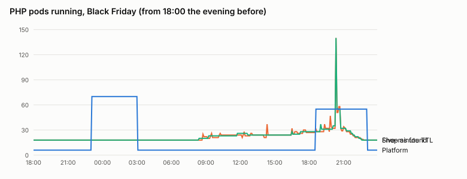
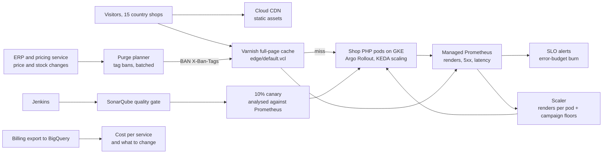
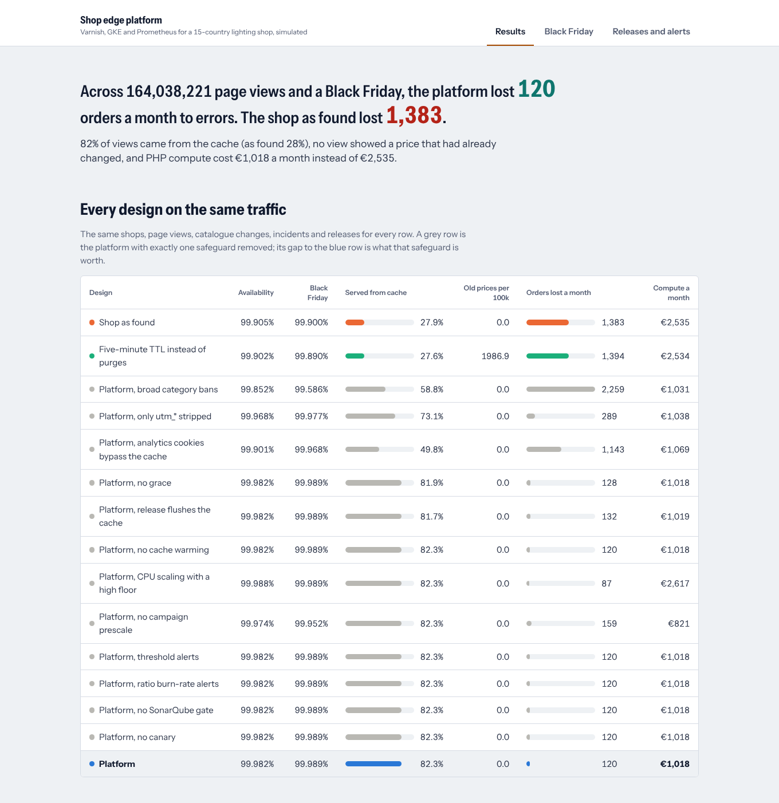
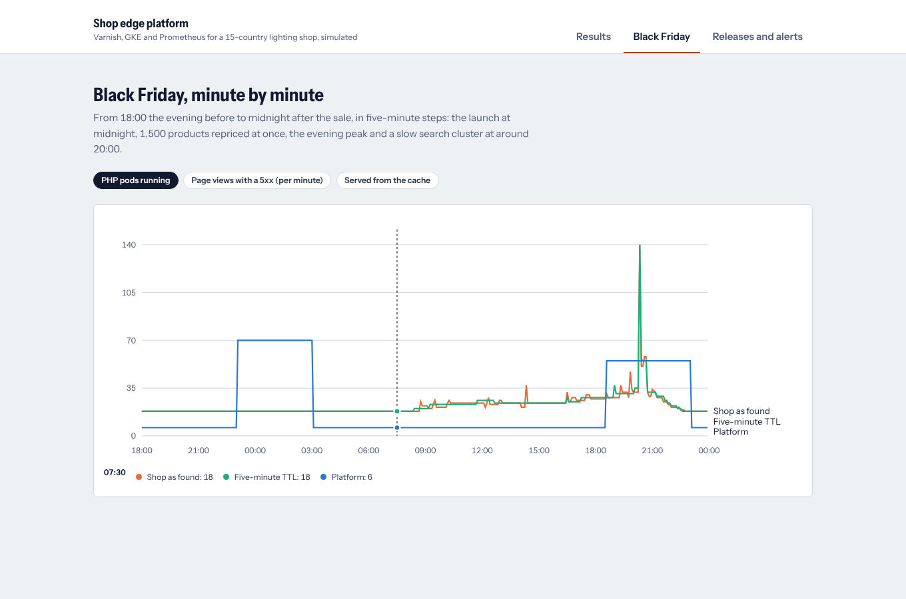
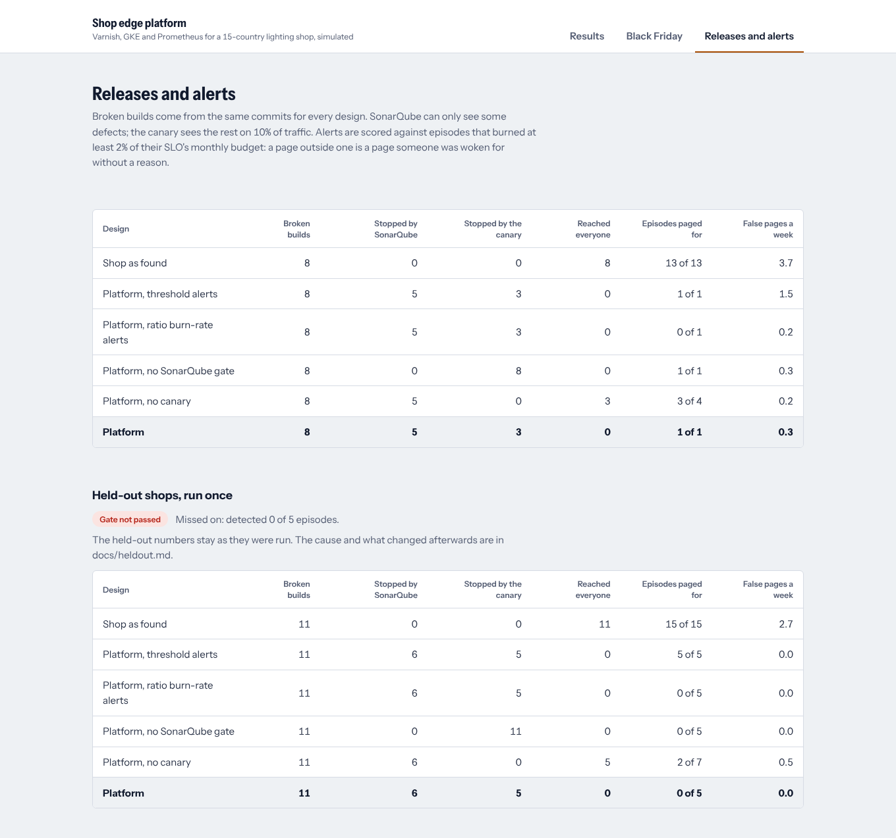

# shop-edge-platform

Platform engineering for a large e-commerce catalogue on GKE:

- Varnish and CDN caching with tag purges;
- Prometheus SLOs with error-budget alerts;
- Jenkins with SonarQube quality gates and canary rollouts;
- cloud cost tracked per service.

It is measured on a simulated 15-country lighting shop, through a Black Friday, against the way such shops are
often run.

**Why.** A big catalogue shop lives or dies by its full-page cache. Three common habits make it fragile:

- **Releases and price runs flush the cache.** Every release cleans it, and every price change bans whole
  categories. The PHP pods then render the shop from scratch, at 400 ms a page, while customers wait.
- **Ad clicks and cookies bypass the cache.** `?gclid=` and `?fbclid=` are unique per ad click, and analytics cookies
  arrive on every visit. Unless both are stripped before the cache key is built, a third or more of visits never hit
  the cache.
- **The tools react late and page often.** CPU-based autoscaling reacts minutes late, so teams set a high replica
  floor and pay for it all night. Threshold alerts wake someone for every two-minute blip.

This repository puts each fix in place: the VCL, the purge planner, the scaler, the alerts, the release gates and
the cost report. It then runs the shop with and without each one on the same traffic.

<!-- results:start -->

### Dashboard (development shops)

| Development | Platform | Shop as found | Five-minute TTL |
|---|---:|---:|---:|
| Page views answered without an error | **99.982%** | 99.905% | 99.902% |
| ... on Black Friday | **99.989%** | 99.900% | 99.890% |
| Served from the cache | **82.3%** | 27.9% | 27.6% |
| Views showing a price that had already changed, per 100k | **0.0** | 0.0 | 1,986.9 |
| Orders lost to errors per month | **120** | 1,383 | 1,394 |
| Orders taken for items out of stock per month | **0** | 0 | 2,509 |
| PHP compute per month | **€1,018** | €2,535 | €2,534 |
| Peak PHP pods | **70** | 140 | 140 |
| Broken builds that reached every visitor | **0 of 8** | 8 of 8 | 8 of 8 |
| Pages that were not about a real problem, per week | **0.3** | 3.7 | 2.2 |

3 simulated shops, 42 days, 164,038,221 page views across 15 country shops, 83,547 price and stock changes, 45 releases (8 broken), 22 incidents and 239 short error blips, Black Friday included.







### Every design on the same traffic

| Design | Availability (95% interval) | Black Friday | Cache hits | Wrong prices per 100k | Lost orders / month | Compute / month | Broken builds to everyone | False pages / week |
|---|---:|---:|---:|---:|---:|---:|---:|---:|
| Shop as found: broad bans, flush on release, CPU scaling, threshold alerts | 99.905% (99.879%–99.929%) | 99.900% | 27.9% | 0.0 | 1,383 | €2,535 | 8 of 8 | 3.7 |
| Five-minute TTL instead of purges | 99.902% (99.876%–99.928%) | 99.890% | 27.6% | 1,986.9 | 1,394 | €2,534 | 8 of 8 | 2.2 |
| Platform, broad category bans | 99.852% (99.789%–99.929%) | 99.586% | 58.8% | 0.0 | 2,259 | €1,031 | 0 of 8 | 4.2 |
| Platform, only utm_* stripped | 99.968% (99.954%–99.979%) | 99.977% | 73.1% | 0.0 | 289 | €1,038 | 0 of 8 | 0.5 |
| Platform, analytics cookies bypass the cache | 99.901% (99.851%–99.943%) | 99.968% | 49.8% | 0.0 | 1,143 | €1,069 | 0 of 8 | 0.2 |
| Platform, no grace | 99.982% (99.976%–99.987%) | 99.989% | 81.9% | 0.0 | 128 | €1,018 | 0 of 8 | 0.3 |
| Platform, release flushes the cache | 99.982% (99.975%–99.987%) | 99.989% | 81.7% | 0.0 | 132 | €1,019 | 0 of 8 | 0.3 |
| Platform, no cache warming | 99.982% (99.976%–99.988%) | 99.989% | 82.2% | 0.0 | 120 | €1,018 | 0 of 8 | 0.3 |
| Platform, CPU scaling with a high floor | 99.988% (99.987%–99.989%) | 99.989% | 82.3% | 0.0 | 87 | €2,617 | 0 of 8 | 0.0 |
| Platform, no campaign prescale | 99.974% (99.964%–99.984%) | 99.952% | 82.3% | 0.0 | 159 | €821 | 0 of 8 | 0.5 |
| Platform, threshold alerts | 99.982% (99.976%–99.988%) | 99.989% | 82.3% | 0.0 | 120 | €1,018 | 0 of 8 | 1.5 |
| Platform, ratio burn-rate alerts | 99.982% (99.976%–99.988%) | 99.989% | 82.3% | 0.0 | 120 | €1,018 | 0 of 8 | 0.2 |
| Platform, no SonarQube gate | 99.982% (99.976%–99.987%) | 99.989% | 82.3% | 0.0 | 120 | €1,018 | 0 of 8 | 0.3 |
| Platform, no canary | 99.982% (99.976%–99.988%) | 99.989% | 82.3% | 0.0 | 120 | €1,018 | 3 of 8 | 0.2 |
| **Platform: tag purges, grace, RPS scaling, burn-rate alerts, gates** | **99.982% (99.976%–99.988%)** | **99.989%** | **82.3%** | **0.0** | **120** | **€1,018** | **0 of 8** | **0.3** |

### Alerts and releases

| Design | Page-worthy episodes | Paged for | Mean minutes to page | Pages in all | Blocked by SonarQube | Caught by the canary |
|---|---:|---:|---:|---:|---:|---:|
| Shop as found | 13 | 13 | 4.0 | 44 | 0 | 0 |
| Platform, threshold alerts | 1 | 1 | 7.0 | 11 | 5 | 3 |
| Platform, ratio burn-rate alerts | 1 | 0 | – | 1 | 5 | 3 |
| Platform, no canary | 4 | 3 | 18.8 | 4 | 5 | 0 |
| Platform, no SonarQube gate | 1 | 1 | 6.0 | 3 | 0 | 8 |
| Platform | 1 | 1 | 6.0 | 3 | 5 | 3 |

### Held-out shops (run once)

| Held-out | Platform | Shop as found | Five-minute TTL |
|---|---:|---:|---:|
| Page views answered without an error | **99.986%** | 99.892% | 99.893% |
| ... on Black Friday | **99.984%** | 99.832% | 99.838% |
| Served from the cache | **81.8%** | 27.6% | 27.6% |
| Views showing a price that had already changed, per 100k | **0.0** | 0.0 | 2,209.5 |
| Orders lost to errors per month | **90** | 1,566 | 1,514 |
| Orders taken for items out of stock per month | **0** | 0 | 2,632 |
| PHP compute per month | **€1,018** | €2,531 | €2,532 |
| Peak PHP pods | **70** | 140 | 140 |
| Broken builds that reached every visitor | **0 of 11** | 11 of 11 | 11 of 11 |
| Pages that were not about a real problem, per week | **0.0** | 2.7 | 1.8 |

3 simulated shops, 42 days, 164,013,841 page views across 15 country shops, 83,818 price and stock changes, 51 releases (11 broken), 15 incidents and 245 short error blips, Black Friday included.

Gate (`config/gate.yaml`) on the held-out shops: **not passed**: detected 0 of 5 episodes.

What happened on the held-out shops, and what changed after: [docs/heldout.md](docs/heldout.md).

<!-- results:end -->

**Reading the results.**

- **Lost orders: cache keys and tag bans.** Most of what the shop loses comes from two places:
  - cache keys that fragment on ad clicks and analytics cookies;
  - bans that throw away whole categories during the sale reprice.

  Each ablation that undoes one of these brings most of the losses back.
- **Stale prices: TTL against bans.** A five-minute TTL is not a fix for stale prices. It shows changed prices for
  minutes at a time, and it sells items that went out of stock.
- **Scaling: CPU with a high floor loses fewer orders.** It does, but it costs more than twice the compute. The
  platform keeps the floor low and lifts it ahead of known campaigns; the table shows the price of each.
- **Paging: the open problem.** The alerts are the weak spot, and the held-out run showed it.
  - **On the held-out shops** the platform's error-budget alerts paged for **0 of 5** episodes, and the gate failed.
    Plain threshold alerts paged for all 5.
  - **The cause, found afterwards on the development shops.** The scoring judged slow pages against the error budget,
    which is ten times smaller than the latency budget the alerts use.
  - **What changed.** The scoring is fixed and the development numbers above use it. The development shops then have
    only one page-worthy episode, which is too few to show the alert design works.
  - [docs/heldout.md](docs/heldout.md) has the record, and [ADR 0003](docs/adr/0003-budget-burn-alerts.md) the
    reasoning.
- **Releases.** SonarQube stops the defects it can see; the canary stops the rest before they reach everyone.
- **Warming and grace matter little here.** Their effect on lost orders is small in this shop. Grace still matters in
  an incident longer than the ones simulated.

## How it works



| Piece | What it does | Where |
|---|---|---|
| **Cache keys** | Marketing parameters (`utm_*`, `gclid`, `fbclid`, `msclkid` and more) and analytics cookies are stripped before hashing; session and cart cookies still bypass the cache. The Python and VCL lists are tested to match. | `edge/default.vcl`, `sep/edge/keys.py` |
| **Tag purges** | A price or stock change bans `p-<id>` (the product's pages in every shop) and `l-<id>` (the category pages that list it), batched into one regex ban. Never whole categories, never a flush. Tested against a real `varnishd`. | `sep/edge/purge.py`, `tests/test_vcl.py` |
| **Grace** | Pages are served stale for up to 6 hours while they refresh and while the shop is down. | VCL |
| **Warming** | After a mass purge (the nightly repricing, the sale switch) or a flush, the most viewed pages are fetched first, at a rate the pods can take. | `warm_order` |
| **Scaling** | KEDA on uncached renders per second (the HPA's arithmetic, in `sep/scale/autoscaler.py`), with the floor raised ahead of known campaigns from `config/platform.yaml`. | `deploy/k8s/base/scaling.yaml` |
| **Alerts** | Multi-window error-budget burn (Google SRE workbook windows), measured in budget, not ratio ([ADR 0003](docs/adr/0003-budget-burn-alerts.md)). Rules are generated, checked by `promtool` and unit-tested: an outage pages, a blip does not. Detection failed on the held-out shops ([docs/heldout.md](docs/heldout.md)). | `sep/slo/burnrate.py`, `ops/prometheus/` |
| **Releases** | SonarQube's quality gate stops what static analysis can see. A 10% canary, analysed every minute against the stable pods' 5xx ratio (Wilson bounds) and render time, stops the rest. A release never flushes the cache. | `Jenkinsfile`, `sep/release/` |
| **Cost** | GKE cost allocation and the billing export to BigQuery give spend per labelled service. A budget alerts at 50%, 80% and forecast 100%. Recommendations come from usage. | `infra/terraform/billing.tf`, `sep/cost/finops.py` |

## The simulated shop, and what is simulated

`sep/world` builds the shop:

- **Catalogue and traffic.** 15 country shops on one catalogue (2,200 products and 110 categories each, Zipf
  popularity) and a diurnal traffic curve, with a Black Friday at 3.6 times normal traffic and a launch spike at
  midnight.
- **What arrives with visits.** Ad clicks with tracking parameters, analytics and consent cookies, and logged-in
  visitors.
- **Catalogue changes.** Price and stock changes from the ERP, a nightly repricing, and 1,500 products repriced at
  the sale switch.
- **Things that go wrong.**
  - Incidents: database failover, a slow search cluster (one is always on the sale evening) and losing a node pool.
  - Short error blips.
  - Releases, some broken. A null reference, a slow query or a config error, of which SonarQube can see only some.
- **List prices** for pods, Varnish nodes and egress.

`sep/sim/engine.py` runs each design's real components against that shop, minute by minute. It scores what visitors
saw against the truth:

- errors and slow pages;
- pages showing a price or stock level that had already changed;
- orders lost to errors;
- pods and cost;
- pages: whether each one was about a real problem, and how fast.

The platform's components never import the world (`tests/test_invariants.py`).

**Limits, stated plainly.**

- **Scale.** The shop is a slice: 2,200 products per country instead of 50,000, and about 2,600 page views a minute.
  Money and orders scale with traffic.
- **The origin.** It is modelled as pods with a render capacity and a latency curve, not as Magento.
- **Infrastructure.** Terraform, Kubernetes manifests and the Jenkinsfile are validated in CI (`terraform validate`,
  `kustomize` and `kubeconform`, `promtool`), but they were not applied to a real GCP project or run in a real
  Jenkins.
- **The VCL.** It runs in a real Varnish in CI, against a small test origin.

## Run it

```bash
pip install -r requirements-dev.txt          # and apt install varnish to run the VCL tests
python -m pytest
python -m sep.eval.cli quick                 # three designs, three days
python -m sep.eval.cli evaluate              # every design, development shops -> reports/, charts, this README
python -m sep.eval.cli gate                  # the platform against config/gate.yaml (held-out shops; --dev for development)
python -m sep.eval.cli rules                 # regenerate the Prometheus rules from config/slo.yaml
uvicorn sep.service.api:app --port 8080      # API and dashboard (after `pnpm build` in web/)
kustomize build --load-restrictor LoadRestrictionsNone deploy/k8s/base | kubectl apply -f -
```

## Dashboard







React, Vite, Tailwind and Framer Motion. It is organised in feature folders (`results`, `blackfriday`, `releases`)
with theme tokens in `web/src/theme`. Every screen has loading, error-with-retry and empty states. It is tested end
to end with Playwright and axe.

## Repository

| Path | What it holds |
|---|---|
| `edge/default.vcl` | The Varnish configuration |
| `sep/edge`, `sep/scale`, `sep/slo`, `sep/release`, `sep/cost` | The platform's components |
| `sep/world` | The simulated shop (the truth) |
| `sep/sim` | The runtime and the designs |
| `sep/eval` | Evaluation, reports, CLI |
| `deploy/k8s/base` | Varnish, the Argo Rollout, KEDA scaling, Managed Prometheus scraping and generated SLO rules |
| `ops/prometheus` | Generated rules and their `promtool` unit tests |
| `infra/terraform` | GKE with Managed Prometheus and cost allocation, node pools, Artifact Registry, Cloud CDN for assets, billing export and budget |
| `Jenkinsfile`, `sonar-project.properties`, `ops/jenkins` | The release pipeline |
| `docs/adr`, `docs/runbooks` | Decisions, and what to do when a page fires |

[AGENTS.md](AGENTS.md) has the invariants and the held-out rule, and [SKILLS.md](SKILLS.md) lists the repeatable
tasks. This repository was built with Claude Code.
